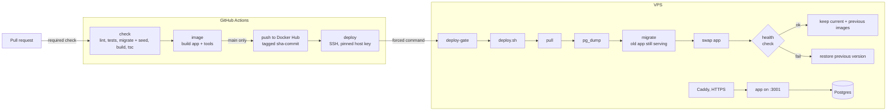

# Deployment

How a merge to `main` reaches https://hs.sepehrgr.dev, in about five minutes and
with no downtime, and what happens when a step fails.



## The parts

**Branch protection.** `main` accepts changes only through a pull request, can't be
force-pushed or deleted, and needs CI's `check` job to pass. The rules apply to
admins too.

**CI** ([`.github/workflows/ci.yml`](../.github/workflows/ci.yml)). `check` runs lint,
unit tests, the migrations and seed against a throwaway Postgres, the production
build and the type-check. `image` builds two images: the app (119 MB compressed)
and a `tools` image with only the Prisma CLI and `tsx`, used for migrations and the
seed. Pull requests only build them; `main` pushes both to Docker Hub, tagged with
the commit, so every running version maps to one commit.

**The image** ([`Dockerfile`](../Dockerfile)). Three stages: dependencies, build,
and a slim runtime that runs as a non-root user. Next.js builds with
`--experimental-build-mode=compile`, so building an image needs no database;
public pages render on each request.

**Deploy.** The `deploy` job checks the server's SSH host key against a pinned
fingerprint, then sends one command: `deploy sha-<commit>`. Its key can't open a
shell: `authorized_keys` ties it to [`deploy-gate`](../deploy/deploy-gate), which
accepts only `deploy <tag>`, `rollback` and `status`.

**On the server** ([`deploy/deploy.sh`](../deploy/deploy.sh)):

1. take a lock, so the hourly reset and a deploy never overlap
2. pull the new images
3. back up the database (`pg_dump`, newest 10 kept, readable by `deploy` only)
4. run the migrations while the old app keeps serving
5. replace only the app container, then check `/` (which also reads the database)
6. on success, delete images older than the previous version

**HTTPS.** Caddy terminates TLS with Let's Encrypt certificates it renews itself.
During the second or two the new container takes to start, it holds requests
(`lb_try_duration`) instead of returning 502.

**The demo database.** A systemd timer reloads the seed every hour, so whatever
visitors change lasts an hour at most. The two published demo logins can't be
edited or deleted.

**Secrets.** Created where they're used, one per machine, never in git or an
image. Inventory and rotation steps: [`secrets.md`](secrets.md).

## When something fails

| Failure | What happens |
|---|---|
| Lint, test, build or type error | `check` fails and the PR can't merge |
| The Dockerfile breaks | `image` fails on the PR, before anything is pushed |
| The server's host key changes | `deploy` refuses to connect |
| The image can't be pulled | Nothing running changes; the deploy fails |
| The backup fails | The deploy stops before migrating and rolls back |
| A migration fails | The new app never starts; the old one keeps serving |
| The new version is unhealthy | Automatic rollback to the previous version, with the rollback point kept; CI turns red |
| A bad migration got through | `deploy.sh restore <backup>` restores in one transaction, all or nothing |

## Operations

Run on the VPS:

```bash
sudo -u deploy /srv/hormozsteel/deploy.sh status          # current and previous version
sudo -u deploy /srv/hormozsteel/deploy.sh rollback        # swap to the previous version
sudo -u deploy /srv/hormozsteel/deploy.sh restart         # apply a changed .env
sudo -u deploy /srv/hormozsteel/deploy.sh seed            # reset the demo data now
sudo -u deploy /srv/hormozsteel/deploy.sh backup
sudo -u deploy /srv/hormozsteel/deploy.sh restore /srv/hormozsteel/backups/<file>
systemctl list-timers hormozsteel-reset.timer             # next and last hourly reset
```

`deploy.sh`, `deploy-gate` and the systemd files are installed by hand; CI doesn't
change files on the server.

## Tested

Measured on the live server with a request every half second:

- a deploy, two rollbacks and a deploy of a tag that doesn't exist: 235 of 235
  requests returned 200, and the failed deploy rolled back on its own
- backup, delete a user, restore: the user came back and the signed-in session survived
- the hourly reset runs on schedule and exits successfully

Breaking it on purpose found three bugs that normal deploys never hit, all fixed:
a failed deploy lost the rollback point, each restart served about 7 seconds of
502s, and old images were never deleted.

## Not done yet

Monitoring: an outside uptime check with alerts, container log rotation, and a disk
guard for deploys.
